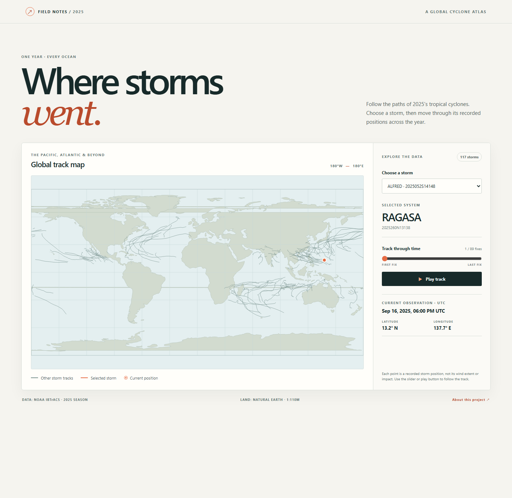

# Where Storms Went — An Interactive 2025 Cyclone Atlas

## Idea and interaction

This experience is for people who are curious about storms but find a yearly
map of hundreds of lines hard to follow. Choose a storm from the list to
highlight its path, then drag the timeline to reveal positions one observation
at a time. The map marker, trail, UTC timestamp and coordinates update together,
so you can see where the storm was and decide which moment to inspect next.
The map opens with Ragasa at its first recorded position, so **Play track**
starts a journey instead of showing the end before the viewer acts. The button
becomes **Pause track** during playback; pressing Play at the end starts again.
Changing the storm or moving the timeline stops playback. If a data file is
unavailable, the page displays an error and asks you to check the local server
before reloading.

The experience answers **“Where did this storm go, and when?”**, not how strong
it was or what damage it caused. The source does not provide complete global
wind-impact measurements.

## Interactive experience



The orange trail and marker show one selected storm; the muted lines keep the
other storms in view for comparison.

Tropical cyclones move across warm oceans, and their paths reveal where these
storms repeatedly form and travel. I chose a global view because the word
"typhoon" is regional: storms in other ocean basins have different names, but
they are part of the same natural phenomenon.

## Data

The track observations come from NOAA's
[International Best Track Archive for Climate Stewardship (IBTrACS)](https://www.ncei.noaa.gov/products/international-best-track-archive).
The committed NetCDF source file contains 4,999 storm records from 1980 onward;
each record stores up to 360 observation times. The plot uses only 2025. Each
valid observation has a UTC time and latitude and longitude in decimal degrees.
The land outlines are from Natural Earth's 1:110m land dataset and are included
in `data/` so the map can be drawn offline.

## Credits

- Storm observations: [NOAA IBTrACS](https://www.ncei.noaa.gov/products/international-best-track-archive).
- Land outlines: [Natural Earth 1:110m land GeoJSON](https://github.com/nvkelso/natural-earth-vector/blob/master/geojson/ne_110m_land.geojson).
- The interactive page uses the committed, trimmed storm observations and local
  land data; its HTML, CSS and JavaScript were made for this project with
  GitHub Copilot assistance.

## Data visualisation


Each circle marks a 2-degree grid cell visited by at least one 2025 storm. Its
colour shows how many distinct storms crossed the cell, with each storm counted
once per cell; the colour scale is logarithmic. This makes recurring ocean
corridors visible, but hides the order and timing of observations, wind strength,
rainfall, and damage. Track density is not an impact footprint: the source does
not provide globally complete wind-radius measurements. The equirectangular
projection also stretches high latitudes, so the map is not an area comparison.

## Run the data visualisation

```bash
uv run plot.py
```

The plotting script declares its Python dependencies in its `uv` script
metadata. The interactive page needs no JavaScript packages or API keys.

## Run the interactive page

From this repository's root, start the Python standard-library static server:

```bash
uv run python -m http.server 8000 --bind 127.0.0.1
```

Open <http://127.0.0.1:8000/web/>. Keep the terminal running while you use the
page; press **Ctrl+C** to stop the server. No internet connection is needed
after the repository is available. Do not open `web/index.html` directly as a
`file://` URL: browsers block its local data-file requests.

## Limitations

The experience displays recorded positions, not interpolated paths, wind
strength, rainfall or damage. Observation times are in UTC. The world map uses
an equirectangular projection, so high latitudes appear stretched. There is no
live deployment; the project runs locally with the supplied data.