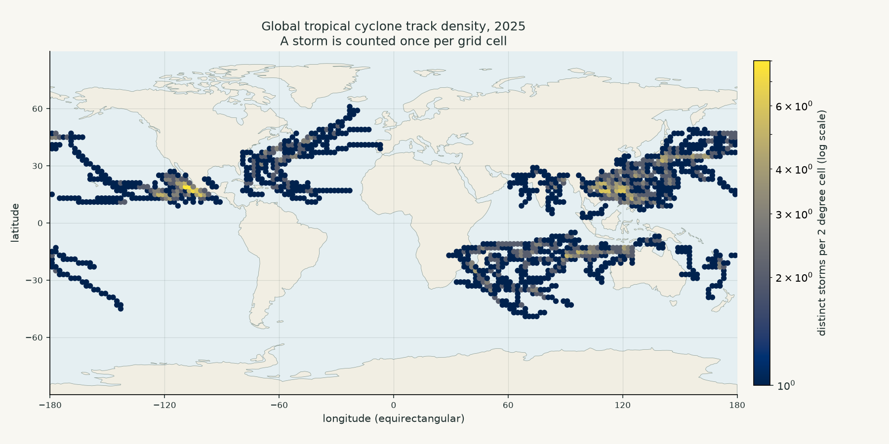

# Global Tropical Cyclone Tracks in 2025

Tropical cyclones move across warm oceans, and their paths reveal where these
storms repeatedly form and travel. I chose a global view because the word
"typhoon" is regional: storms in other ocean basins have different names, but
they are part of the same natural phenomenon.

## Data

The track observations come from NOAA's
[International Best Track Archive for Climate Stewardship (IBTrACS)](https://www.ncei.noaa.gov/products/international-best-track-archive).
The committed NetCDF source file contains 4,999 storm records from 1980 onward;
each record stores up to 360 observation times. The plot uses only 2025. Each
valid observation has a UTC time and latitude and longitude in decimal degrees.
The land outlines are from Natural Earth's 1:110m land dataset and are included
in `data/` so the map can be drawn offline.

## Picture



Each circle marks a 2-degree grid cell visited by at least one 2025 storm. Its
colour shows how many distinct storms crossed the cell, with each storm counted
once per cell; the colour scale is logarithmic. This makes recurring ocean
corridors visible, but hides the order and timing of observations, wind strength,
rainfall, and damage. Track density is not an impact footprint: the source does
not provide globally complete wind-radius measurements. The equirectangular
projection also stretches high latitudes, so the map is not an area comparison.

## Run

```bash
uv run plot.py
```